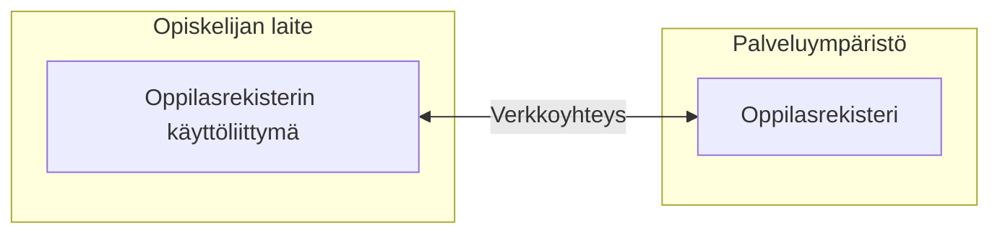

# Oppilasrekisteri vaatimusmäärittely

Aloita kertomalla, mikä ongelma ratkaistaan ja keitä ratkaisu palvelee. Tämän esimerkin tavoitteena on, että opiskelija voi tarkistaa omat tietonsa ja ilmoittautua kursseille itsenäisesti. Käyttäjä on opiskelija; oppilaitos puolestaan määrittelee, mitä tietoja ja kursseja palvelussa tarjotaan.

## Vaatimukset ja hyväksymiskriteerit

## Järjestelmän toiminnan kuvaus


## Käyttötapauskaavio

```mermaid
usecase-beta
    direction LR
    actor Student("Opiskelija")
    systemBoundary Application["Oppilasrekisteri"]
        Login("Kirjaudu sisään")
        ViewInfo("Katso henkilötiedot")
        ViewGrades("Katso arvosanat")
        RegisterCourse("Ilmoittaudu kurssille")
        Logout("Kirjaudu ulos")
    end

    Student --> Login
    Student --> ViewInfo
    Student --> ViewGrades
    Student --> RegisterCourse
    Student --> Logout
    ViewInfo ..> : include Login
    ViewGrades ..> : include Login
    RegisterCourse ..> : include Login
```