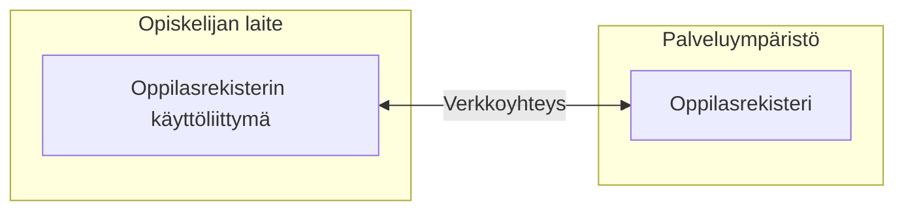

# Oppilasrekisteri vaatimusmäärittely

Aloita kertomalla, mikä ongelma ratkaistaan ja keitä ratkaisu palvelee. Tämän esimerkin tavoitteena on, että opiskelija voi tarkistaa omat tietonsa ja ilmoittautua kursseille itsenäisesti. Käyttäjä on opiskelija; oppilaitos puolestaan määrittelee, mitä tietoja ja kursseja palvelussa tarjotaan.

## Vaatimukset ja hyväksymiskriteerit

## Järjestelmän toiminnan kuvaus

